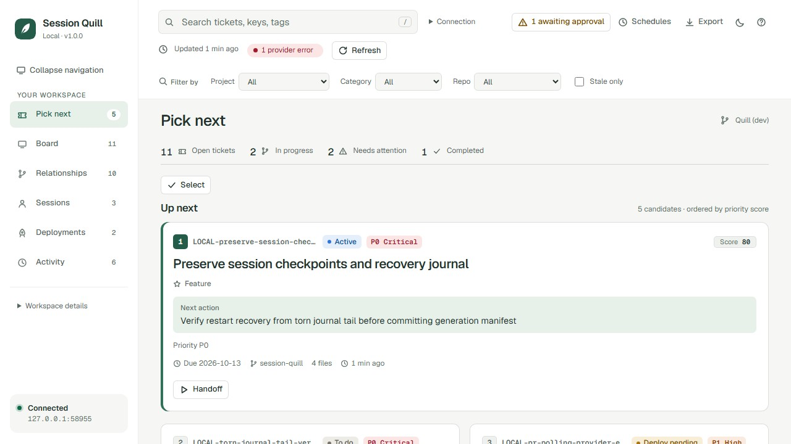
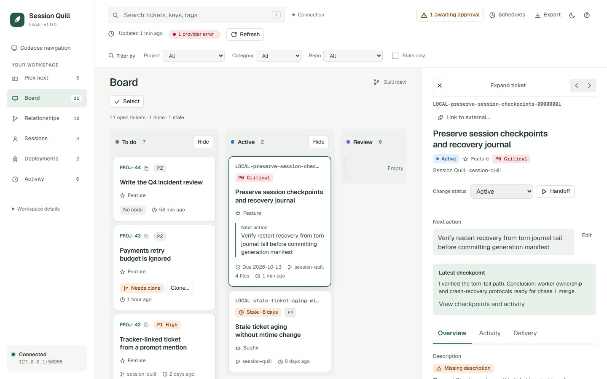

# Session Quill

[](https://github.com/nulllvoid/session-quill/actions/workflows/ci.yml)
[](LICENSE)


A Claude Code plugin that binds development sessions to tickets, keeps a durable local record of what each session did, and gives you a loopback dashboard that answers "what should I pick next?", "where was I?" and "what still needs deployment?".



- **Zero-command tracking.** Mention a ticket key such as `PROJ-123` in a prompt, or start on a branch like `feat/PROJ-123-...`, and the session is linked to that ticket. Any tracker works through a URL template; no tracker host is built in.
- **Unlinked work inbox.** Files and commits from a session with no ticket wait on Pick next. Attach them to a ticket, create the ticket from its key, or dismiss them; each action has a 10-second undo. Tracker keys open their ticket in a new tab and copy with one click.
- **Ticket gate modes.** `nudge` (default) never blocks and asks once at the end of a turn about unlinked work. `strict` denies supported write tools, unknown shell commands and unregistered tools until the session is bound, while dedicated reads and a tested read-only shell subset pass through. `off` only captures. The gate is a workflow aid, not a sandbox: `/session-quill:ticket off` disables it per session, audibly.
- **Durable capture.** Hooks persist events to local ingress before acknowledging; one worker per store journals them, rebuilds generated state, and writes markdown notes (plain folder or Obsidian vault) within 30 seconds. Your own Summary and Notes sections are preserved byte-for-byte.
- **Dashboard.** Pick next, Board, Tree, Sessions, Deployments and Today views with revision-checked edits, a 10-second undo window, explicit conflicts, scheduled reconciliation (every two hours unless you set your own schedules) and a Refresh that runs immediately.
- **Schedules and providers.** Named jobs run on cron or interval schedules in your time zone, with a Schedules panel and Run now. PR state comes from GitHub (`gh`) or Bitbucket Cloud and Server.
- **Sharing.** Read-only standalone HTML snapshots with an export time; no credentials, request code or local paths.
- **Agent recipes.** Analyse, analyse with follow-ups, attempt a fix, check deployments or write a standup, or add your own recipes as Markdown files. Each runs in an isolated Git worktree with explicit read/edit/commit/push/draft-PR permissions that the recipe caps, and its suggestions wait for you to accept them.
- **Environments and Today.** Each merged PR owes a deployment per environment, shown as a PR-by-environment matrix with the evidence for each. Today lists what happened on each day of the last week, and a digest job writes the same summary into your daily note.
- **Publishers.** Share a roll-up note, a read-only HTML copy or a live claude.ai artifact page. Each sends only the fields and projects you list, and only after you confirm the destination.
- **Tracker sync and two-way pages.** Read status, assignee and fix version from Jira, GitHub or Linear on a schedule; sync never writes. Opt in to push one ticket's status back yourself, previewed and confirmed. On a two-way artifact page, teammates' status and next-action changes come back as revision-checked edits, and their comments join the ticket's timeline. With Run agent on, they can propose an agent run that waits for your Approve.

## What's new in 2.1

Reconciliation now checks all remaining work before closing a ticket, preserves manual reopens, and revisits old or failed checks fairly. **Runs → Needs you** shows closure reviews; ticket detail offers **Completion settings**, **Resolve ticket**, and **Reviewed — keep open**. Required children block their parent; independent follow-ups do not. Exact repeated agent findings are suppressed or linked to existing children, and new follow-ups require your acceptance.

On upgrade, the worker rebuilds its checkpoint from the journal. Review legacy child relationships before enabling grouping-parent completion. See the [2.1.0 changelog](CHANGELOG.md#210---2026-10-30) for behavior changes and [ADR 0042](docs/decisions/0042-reconciliation-closure.md) for the closure rules.

## What's new in 2.0

- **A worktree per ticket.** `quill ticket work … --worktree` gives a ticket its own branch and checkout outside the repository, so two sessions can work on two tickets at once. See [Ticket worktrees](#ticket-worktrees).
- **Review a fix on the dashboard.** Run detail shows the fix's diff grouped by file path, with **Retry as new run** on any hunk. It also has snapshots of the checkout at each step, which you can restore. See [Reviewing a fix run](#reviewing-a-fix-run).
- **An optional second opinion.** A read-only critic can review a fix after its tests pass. Its notes are labelled as the critic's opinion, never as Quill's check.
- **Evidence in the pull request.** A fix run's draft PR carries a receipt of what the worker saw: test runs, guard counts, change counts and a digest. `quill receipt` rebuilds it.
- **CI on Quill's pull requests.** The worker watches GitHub checks on PRs its runs opened. When CI fails it proposes a fix, which runs only if you approve it on the dashboard.
- **Needs you, grouped.** Runs → Needs you groups items into Needs your decision, Tests or CI failed, Other failures, Ready to review and Live.
- **Safer critical changes.** An approval can be valid for 5, 15 or 60 minutes. A pinned `kubectl` or `psql` write waits for its server-side dry run. See [Critical changes](#critical-changes).
- **Planned files.** Writes outside an approved plan show as drift in the status line and on runs. Drift is observed, never blocked. See [Planned files](#planned-files).
- **Memory that notices change.** A learning about code goes stale when that code is rewritten. One about the run environment goes stale when that environment changes. A repeated test failure is recognised by its signature. See [Memory](#memory) and [MCP servers in autonomous runs](#mcp-servers-in-autonomous-runs).
- **Secrets stay out of the journal.** Tokens in known formats are redacted from hook and CLI events before they are stored. See [Privacy and limits](#privacy-and-limits).
- **Faster start, faster status line.** The worker resumes from a state checkpoint instead of replaying the whole journal. The status line loads less code. `quill doctor` shows per-recipe counts.

The full list is in [CHANGELOG.md](CHANGELOG.md); every new field is in [DATA-CONTRACT, "2.0.0 index"](docs/DATA-CONTRACT.md#200-index).

## Documentation

| For | Read |
| --- | --- |
| Using the plugin | This README, then `node bin/quill.js help` |
| Product website and GitHub Pages deployment | [site/README.md](site/README.md) |
| How it works inside | [docs/ARCHITECTURE.md](docs/ARCHITECTURE.md) |
| What it must do (spec) | [docs/README.md](docs/README.md): PRD, TRD, data contract, UI spec, decisions |
| What has been verified | [docs/ACCEPTANCE.md](docs/ACCEPTANCE.md) and [docs/ACCEPTANCE-RESULTS.md](docs/ACCEPTANCE-RESULTS.md) |
| Contributing | [CONTRIBUTING.md](CONTRIBUTING.md), [CODE_OF_CONDUCT.md](CODE_OF_CONDUCT.md), [SECURITY.md](SECURITY.md), [CHANGELOG.md](CHANGELOG.md) |

## Prerequisites

- **Node.js 22 LTS or newer**, installed explicitly. Node is **not bundled** with Claude Code; the hooks run `node` from your `PATH`.
- **Claude Code 2.1.x** (verified with 2.1.288).
- **Git** and an authenticated **`claude`** CLI only if you use agent recipes. **`gh`** only for GitHub PR polling, and a Bitbucket or tracker token only if you use those integrations.
- A **claude.ai** sign-in in Claude Code only for artifact publishers. Live pages are published from a Claude Code session, because headless `claude -p` has no Artifact tools.

Supported platforms are recorded after each acceptance run in `docs/ACCEPTANCE-RESULTS.md`. CI runs the suite on Windows, macOS and Linux with Node 22 and 24.

## Get started inside Claude Code

From the repository you want to track, install the plugin:

```text
/plugin marketplace add nulllvoid/session-quill
/plugin install session-quill@session-quill
```

Start a new Claude session to load the plugin, then run:

```text
/session-quill:start
```

Keep coding. Quill detects the repository, saves its registration privately, starts
its background worker, and captures the current session. No CLI alias, tracker
connection, ticket, or repository configuration file is required. Node 22 or newer
must still be on your PATH; it is not bundled with Claude Code.

Open your dashboard whenever you need it:

```text
/session-quill:ui
```

The dashboard command also sets up Quill if needed, attaches your current Claude
session and repository, and starts a missing worker.
After a reboot, the next Claude session reconnects automatically. You do not need
to configure Task Scheduler or systemd for ordinary session tracking. Scheduled
jobs run while the worker is running; opening Claude after downtime starts recovery.
To have the worker (and the dashboard) running from the moment you log in, run
`quill worker install` once; `quill worker uninstall` removes it.

The dashboard lives at `http://127.0.0.1:47321/` (set `ui_port` in
`~/.claude/quill/config.toml` to change it, or `ui_port = 0` for a random port; a `ui_port = 0` saved by a release before
the fixed port is treated as unset once;
when the port is taken the worker uses a random one). The first visit needs the
one-use link from `/session-quill:ui`; after that the browser stays signed in for
7 days from its last use, across worker restarts. A browser that is not signed in
sees a page telling it how to sign in. `quill ui --revoke` signs every browser out. See [ADR 0022](docs/decisions/0022-always-on-dashboard.md).

Quill keeps your existing store. A first setup uses `~/.claude/quill/store`
(or `QUILL_HOME/store` when set). To choose a notes folder instead, run
`/session-quill:start --store <folder>` on first setup. To write team defaults
into a committable `.quill.toml`, explicitly use `--share-settings`.
Existing gate policies are preserved, including strict repository policies.

If something is wrong, use `/session-quill:status`. Run `/session-quill:start`
to reconnect or resume processing inside Claude. `/session-quill:doctor` (or
`quill doctor`) provides detailed diagnostics. A stopped worker stays stopped until you explicitly
resume it with `start`; hooks continue durable capture where storage is available.

### Terminal and advanced setup

The same install commands work from a terminal with `claude plugin` in place
of `/plugin`. Update with `claude plugin marketplace update session-quill`
and `claude plugin update session-quill@session-quill`.

From a development clone, use `claude --plugin-dir /path/to/session-quill`.
`npm link` optionally exposes `quill` on PATH. Otherwise run
`node /path/to/session-quill/bin/quill.js` in place of `quill`.
The Claude commands always locate their bundled CLI automatically.

```bash
quill start                                 # private setup or resume
quill ui                                    # open dashboard, starting worker if needed
quill worker stop                           # pause processing and automatic restart
quill worker install                        # start the worker at login (uninstall to remove)
quill ui --revoke                           # sign every dashboard browser out
quill start                                 # resume; captured activity catches up
quill init --store ~/Documents/Quill --project my-project --project-name "My Project"
quill repo add ~/src/payments-api
quill repo list
```

`quill init` retains the advanced interactive setup, including repository defaults.
`start` uses sensible defaults without prompts and requires a Git work tree.
The worker remains a single owner per store; it never takes ownership from another
machine. Automatic launch attempts are rate-limited to avoid a crash loop.

## Link sessions to your tracker

### Internal tasks, across sessions

Tickets represent tasks, not sessions. A session can work on several tickets;
one ticket can carry work from several sessions. Claude receives task-tracking
instructions to reuse or create a ticket before substantive work, and to keep
follow-ups, corrections, and retries on the same task. Starting a session alone
does not create a ticket.

When a session binds to a ticket that already has history (at session start, after
compaction, when a prompt mentions its key, or through `ticket bind` and `ticket work`),
Claude also gets a short brief of where the work stands: the goal, next action or
blocker, the approved plan, recent conclusions, recently changed files, PRs and pending
deployments. It is read from the ticket's projection, capped at 1,200 characters, and
absent for a ticket nothing has happened on yet.

Each ticket also tracks effort: active time (gaps of up to 5 minutes between its
sessions' events), turns, and the tokens Claude Code reports for those turns. The
Stop hook reads only the numeric usage of the newest transcript lines; no text is
kept. The ticket's detail panel and `ticket show` display it, for example
`2 h 10 min active · 14 turns · 1.2M tokens (36k output)`.

Every ticket Claude creates has a description in one format, which the dashboard shows and agent runs read as context ([ADR 0014](docs/decisions/0014-ticket-descriptions.md)):

```markdown
**Goal:** Make retry() call fn up to `attempts` times.

**Context:** retry.js gives up one attempt early (loop bound at retry.js:4). Keep the signature.

**Done when:**
- retry(fn, { attempts: 3 }) calls fn 3 times
- npm test passes
```

`ticket create` and `ticket work` refuse a missing or malformed description and print the format, so Claude writes it as it creates the ticket. Tickets made without an agent (a tracker key in a prompt, migration, the dashboard) are flagged, and the next session on them is asked to write one with `ticket set <KEY> --description`. `analyse` fills in a missing description and every follow-up child it proposes carries one; neither ever replaces a description that is already valid.

Use `/session-quill:ticket work "Improve onboarding"` to reuse a uniquely matching
open task in this project/repository or create it and switch to it. General tasks
use `DEV-1`, features use `FEAT-1` (`--category feature`), and fixes use `FIX-1`
(`--category bugfix`). Numbers are allocated by the worker, safely across parallel
sessions. `create` always makes a separate task; `bind DEV-1` resumes a known task.
If several tasks match a title, Quill asks you to select a key.

Switching tickets affects future activity only. Existing keys and aliases remain
valid, custom `key_prefix` settings are respected, and child keys such as
`FEAT-1.1` remain supported. An external tracker is optional. Ending a session
does not mark its tasks done.

### External trackers

Add a `[tracker]` table to the repository's `.quill.toml` (shared with your team) or to `~/.claude/quill/config.toml` (just you). Secrets never go in either file.

```toml
[tracker]
system       = "jira"                          # jira | linear | github | custom
domain       = "https://example.atlassian.net"
url_template = "{domain}/browse/{key}"         # linear: "{domain}/issue/{key}" · github: "{domain}/{repo}/issues/{number}"
key_pattern  = '\b([A-Z][A-Z0-9]+-\d+)\b'      # the default; single quotes keep backslashes literal
prefixes     = ["PROJ", "OPS"]                 # empty = any key except common tokens like UTF-8
sources      = ["prompt", "branch"]
on_new_key   = "switch"                        # switch | add | ignore

[gate]
mode = "nudge"                                 # off | nudge | strict
```

A repository can make the gate stricter than your own setting but never looser, and it can narrow your `prefixes` list but never widen it. In `strict` mode a mention only links the session when `prefixes` is set. A `.quill.toml` that cannot be parsed makes its repository strict until it is fixed. Patterns match within whitespace-free words of up to 100 characters. The worker picks up edits to either file within about 10 seconds. `gate_enabled = false` still works and means `mode = "off"`.

## Ticket worktrees

Give a ticket its own checkout when you work on more than one ticket in a repository at a time:

```bash
/session-quill:ticket work "Retry budget for uploads" --worktree
/session-quill:ticket bind PROJ-42 --worktree
```

Quill creates the worktree at `~/.claude/quill/worktrees/<repo>/<KEY>`, outside the repository, on the branch `quill/<KEY>`. The branch starts from the ticket's latest recorded branch, or else from the repository's HEAD. An existing `quill/<KEY>` branch is checked out as it is. The command prints `Worktree path: …`, and Claude switches into that path and makes every edit, test and commit there. Your repository's own checkout is not touched. Ignored files listed in `[worktree] copy` are copied in, never linked; a tracked file is never copied. Agent runs never get a ticket worktree: they have their own checkouts.

```toml
[worktree]                       # user config only (~/.claude/quill/config.toml)
auto = false                     # true: ticket work|bind mount a worktree without --worktree (--no-worktree skips it)
copy = [".env", ".env.local"]    # repository-relative ignored files copied into a new worktree
keep_days = 7                    # how long a done ticket's clean worktree stays
```

```bash
quill worktree list [--all] [--json]   # each worktree and its state on disk: clean, uncommitted changes, detached HEAD, missing
quill worktree remove PROJ-42          # removes a clean one; the branch is always kept
```

The worker removes a ticket's worktree once the ticket has been done for `keep_days` and no live session uses it. It never removes one with uncommitted changes, a detached HEAD that no branch contains, or a copied ignored file you changed. Such a worktree is kept and `quill worktree list` says why. Removal uses `git worktree remove` without `--force`, and there is no force option. The dashboard does not show ticket worktrees yet ([ADR 0036](docs/decisions/0036-ticket-worktrees.md)).

## Schedules

Without configuration the worker reconciles every two hours. To choose your own cadence, add `[[schedule]]` tables to `~/.claude/quill/config.toml` (repositories cannot schedule jobs):

```toml
[[schedule]]
name = "reconcile"
job  = "reconcile"
every = "2h"                 # or 30m, 1d

[[schedule]]
name = "evening-sync"
job  = "reconcile"
cron = "30 19 * * 1-5"       # minute hour day-of-month month day-of-week, in the store's time zone
```

A run missed while the computer was off runs once when the worker starts. Open **Schedules** in the dashboard header for next and last runs and **Run now**. Jobs: `reconcile` checks PRs, `agent` runs a recipe, `digest` writes a daily summary, `publish` runs publishers and `tracker-sync` reads your tracker (each is described below).

## Environments, Today and the daily digest

List your deployment environments once in `[tracker]`; a repository's own `deployment_environments` in `config.toml` still wins (repositories registered by older versions of `quill init` list `["production"]`; remove that line to use the tracker's list).

```toml
[tracker]
environments = ["stage", "prod"]
```

Each merged PR then owes one deployment per environment. The ticket shows pending, done or N/A for each, with the evidence you or an agent recorded (a values-file tag bump, an ArgoCD sync, a release), and stays on Deployments until nothing is pending. **Today** (shortcut 6) shows the last week day by day and ticket by ticket. To get the same summary in your notes:

```toml
[[schedule]]
name = "daily-digest"
job  = "digest"
cron = "30 19 * * 1-5"
to   = ["vault-daily"]           # the store's daily/YYYY-MM-DD.md; or ["file"] with path = "notes/digest.md" (relative to the store, or ~/...)
```

The digest lives between `<!-- quill:digest:start -->` and `<!-- quill:digest:end -->`; your own text in the note is never touched, and if you edit the digest section Quill stops updating it until you empty it again.

## Publishing

Share a current view of your tickets with `[[publish]]` entries in `~/.claude/quill/config.toml`:

```toml
[[publish]]
name     = "team"
kind     = "artifact"          # a live claude.ai page; or "markdown" (a roll-up note) or "html" (a read-only copy, with path = "...")
projects = ["my-project"]
fields   = ["key", "title", "status", "next", "pr", "deployments", "updated"]
```

Only those fields of those projects are sent, through the same filter as exports (no local paths, links only with `include_links = true`). The first publish to a destination waits for you to confirm it, from **Publish** in the dashboard header or with `quill publish team --confirm`. A live artifact is published from a Claude Code session, which has the Artifact tools: run `/session-quill:publish team`. Later publishes update each row in place and keep anything someone edited on the page. Add `on = ["reconcile"]` to republish a note or copy after every reconciliation. With `two_way = true`, people you let edit the page can change a ticket's status or next action there; the next publish turns each change into an edit that applies unless the ticket changed since, and comments that name a ticket appear on its timeline.

Add `run_agent = true` to a two-way publisher to give page editors a **Run agent** select. It offers read-only recipes (analyse, analyse-followups, deploy-check, standup, workspace-setup and your personal read-only ones), plus any built-in or personal recipe you list in `run_recipes`. A repository recipe that shadows the offered one is refused. A pick never starts a run. The next publish turns it into a **proposed run**, shown in Today and on the ticket, with the editor as the page reported them, the recipe and the access it would get (always standard, never commit, push or a PR). Approve or dismiss it there, or with `quill approve --run` (lists them), `quill approve --run <id>` and `quill dismiss --run <id>`. An approved run is an ordinary run whose results arrive as suggestions; if the ticket already has a run, Approve says so. Open proposals lapse after 7 days or once the ticket is done. Every proposal needs your approval: the editor id comes from the page, and anyone who can edit the page can write it, so there is no auto-approval.

```toml
[[publish]]
name = "team"
kind = "artifact"
two_way = true
run_agent = true
run_recipes = ["attempt-fix"]          # also offered; still needs your Approve
```

## Tracker sync

To see what your tracker says about each linked ticket (status, assignee, fix version), name the token variable in `[tracker]` and schedule a sync. Quill only reads; it never writes to the tracker and never changes its own status from it.

```toml
[tracker]
system         = "jira"
domain         = "https://example.atlassian.net"
sync_token_env = "JIRA_TOKEN"        # an API token; for Jira Cloud also set sync_username_env = "JIRA_EMAIL"

[[schedule]]
name = "tracker-sync"
job  = "tracker-sync"
every = "6h"
```

GitHub (`GITHUB_TOKEN`, with `repo = "owner/name"`) and Linear (`LINEAR_API_KEY`) work the same way. The token is sent only to the tracker in your own config, never to one a repository names.

### Pushing a status back (opt-in)

Sync never writes. To copy a ticket's status to its issue yourself, turn on write-back in your own `config.toml` (a repository's `.quill.toml` cannot) and push one ticket at a time:

```toml
[tracker]
write_back = true                    # the token needs write scope
[tracker.status_map]                 # optional; defaults: To Do, In Progress, In Review, Done
review = "Code Review"
```

```bash
quill tracker push PROJ-7                          # preview: current remote status and the change; sends nothing
quill tracker push PROJ-7 --confirm                # sends it
quill tracker push PROJ-7 --to "Blocked" --comment "Waiting on infra" --confirm
```

GitHub issues close for done and reopen otherwise. Each push, or failure, is recorded on the ticket's timeline. Nothing pushes automatically ([ADR 0018](docs/decisions/0018-tracker-write-back.md)).

### Start from your assigned issues (opt-in)

Quill can fill the board with the open issues assigned to you and find the repository each one belongs to. Everything here is in your own `config.toml`; a repository's `.quill.toml` cannot turn it on ([ADR 0024](docs/decisions/0024-tracker-onboarding.md)).

```bash
quill init --bootstrap-from-tracker   # turns on import_assigned, adds a tracker-sync schedule, imports once
quill tracker import                  # one import now (idempotent)
```

```toml
[tracker]
import_assigned = true                # Jira: assignee = currentUser() AND statusCategory != Done; GitHub: is:open assignee:@me in repo
auto_clone_dir  = "~/quill-repos"     # where confirmed clones go (default ~/quill-repos)
clone_hosts     = ["github.com", "gitlab.com", "bitbucket.org"]   # the only hosts Quill clones from (this is the default)

[tracker.repo_map]                    # optional: first match wins
"PROJ/Payments" = "payments"          # a Jira component -> a registered repository id
PROJ            = "git@github.com:acme/backend.git"   # a Jira project -> a remote
"acme/web"      = "web"               # a GitHub repository -> a registered repository id
```

Each `tracker-sync` run imports new issues as tickets (under their tracker key; an issue already tracked is skipped) and then resolves the repository of tickets that have none, by rules, never by an agent: the `repo_map` entry for the issue's component, project or GitHub repository; else a registered repository whose `origin` is a repository the issue links to (the GitHub issue's own repository, or Jira remote links on a `clone_hosts` forge); else a clone already in `auto_clone_dir` or beside your registered repositories. A match links the ticket. A remote with no clone shows **Needs clone** on the card; nothing is cloned until you confirm:

```bash
quill repo clone PROJ-12              # preview: remote, host check, target folder; clones nothing
quill repo clone PROJ-12 --confirm    # clone, register like `quill repo add`, link the ticket
quill repo clone PROJ-12 --url git@github.com:acme/api.git   # name the remote yourself
quill ticket set PROJ-14 --no-code yes                      # this ticket needs no repository
```

The dashboard's **Clone…** button opens the same preview. Quill clones only `https://` and `ssh` remotes on a `clone_hosts` host, refuses addresses with credentials, `file:` and `ext::` transports, and never clones a remote that already has a clone (it links or registers that one instead). The Repo filter has a **Needs clone** value, and the read-only `workspace-setup` recipe can suggest a `repo_map` line for a ticket the rules could not place.

## Your board on another machine

One machine owns a store and is the only one that writes it. To see the board elsewhere, let the owner keep a read-only mirror inside the store folder and sync that folder with whatever you already use (OneDrive, Dropbox, Syncthing, a private git repository):

```toml
[mirror]
enabled = true
# path = "~/Dropbox/quill-mirror"   # default: <store>/.quill-mirror
# projects = ["payments"]           # default: all projects
# include_links = false             # PR and tracker links stay out unless true
```

On the other machine:

```bash
quill mirror status --dir "<synced store>/.quill-mirror"   # when it was written, by which machine, how many tickets
quill mirror open --dir "<synced store>/.quill-mirror"     # opens the read-only dashboard
```

The mirror uses the same privacy rules as a shared snapshot (no checkpoint text, no local paths or credentials) and refreshes at most once a minute while the owner's worker runs ([ADR 0019](docs/decisions/0019-read-only-mirror.md)).

## GitHub pull requests and automatic closing

Set the repository's provider to GitHub (`gh` must be signed in). Reconciliation follows each linked PR and can link a PR to the exact ticket whose worker run opened it. Branch discovery links only unambiguous captured work; a branch shared by multiple tickets needs review. If merging is your release (a plugin or a library), configure it below. Merged tickets then close when all remaining obligations are satisfied, instead of waiting for separate deployment evidence:

```toml
[repos.my-repo]
provider = "github"
deploy_on = "merge"     # omit to keep per-environment deployment obligations
```

Work committed directly on the default branch is never matched by branch; open a PR for it or set its status yourself ([ADR 0021](docs/decisions/0021-pr-closes-its-tickets.md)).

## Bitbucket pull requests

Set the repository's provider in `~/.claude/quill/config.toml` and put a token in an environment variable the worker can read. Quill never stores the token, and sends it only to the host you configure.

```toml
[repos.my-repo]
provider = "bitbucket"
token_env = "BITBUCKET_TOKEN"                       # an access token, sent as a bearer token
# username_env = "BITBUCKET_USERNAME"               # set this to use an app password with basic auth instead
# provider_url = "https://bitbucket.example.com"    # Bitbucket Server/Data Center; omit for bitbucket.org
```

## Agent recipes

A recipe is a Markdown file with frontmatter and a prompt. Quill ships `analyse`, `analyse-followups`, `attempt-fix`, `deploy-check`, `verify-deploy` (read-only post-deploy health through Argo CD and Kibana), `file-task`, `standup` and `workspace-setup`, plus `critical-change`, which runs only from an approved critical change, and `critic-review`, which runs only as a fix run's critic step (see [Reviewing a fix run](#reviewing-a-fix-run)); add your own in a repository's `.quill/agents/` (shared, and preferred for that repository) or in `~/.claude/quill/agents/` (just you).

```markdown
---
name: deploy-check
description: Check whether each merged PR reached each environment
mode: analyse                      # analyse | analyse-followups | attempt-fix
permissions: { read_source: true } # the most a run may get
tools: [Read, Grep, "Bash(git log:*)"]
timeout_min: 10                    # 1 to 60; without it, 30 for autonomous runs and 20 otherwise
inputs: [ticket, prs, deployments, work]   # also notes, related, history; omit for all
outputs: [summary, deploy_evidence, next_action]
self_check: true                   # verify each claim against its source before finishing (always on with edit_source)
# max_turns: 60                    # optional turn and spend caps (1.1.0); a recipe that uses them,
# max_budget_usd: 3                #   or requires, must declare quill_min_version: "1.1.0"
# x-team-owner: payments           # keys starting with x- are yours and ignored (1.1.0)
---
For {{ticket.key}} ({{ticket.url}}): for each merged PR {{prs}}, find the deployment evidence...
```

To use recipes someone else published, install them from a Git repository or a folder. The first command shows what each recipe may do and installs nothing; `--confirm` installs, recording where each came from:

```bash
quill agent install https://github.com/acme/quill-recipes --ref v1.2
quill agent install https://github.com/acme/quill-recipes --ref v1.2 --only triage --confirm
quill agent uninstall triage                       # only while it is unchanged
```

Installed recipes are ordinary personal recipes: their permissions are still a ceiling and each run still asks ([ADR 0020](docs/decisions/0020-shared-recipes.md)).

Run one from the ticket's Agents panel, with `quill agent run deploy-check PROJ-123`, with `/session-quill:agent run deploy-check PROJ-123`, or on a schedule:

```toml
[[schedule]]
name   = "deploy-followup"
job    = "agent"
cron   = "0 11 * * 1-5"
recipe = "deploy-check"
scope  = "deploy-pending"          # deploy-pending | active | review | blocked | open
```

Every run sees the ticket's Notes section, the full latest plan and checkpoint, the work so far (files, commits and, with source access, their diff), the tickets around it and what earlier runs suggested, as far as its `inputs` allow. Each reply says how confident it is and lists its sources; a reply that breaks the format gets one repair turn ([ADR 0013](docs/decisions/0013-recipe-context-and-reply-contract.md)).

**Tickets without a repository** have no PRs to move their status, so after a turn that worked on one, Claude checks its Done when items and sets it to Review when they are met (at most once per 30 minutes of work; [ADR 0016](docs/decisions/0016-done-when-check.md)). They can also run `file-task` on their attached files, for chores such as deleting a leftover script. The agent works on copies; Quill applies its edits and deletions to the originals, moves deleted files to a Quill trash folder, and shows each change on the run with **Undo**. Edit and delete permissions stay off until you tick them, nothing outside the ticket's attached files is in reach, and a run that changed files moves the ticket to Review for you to confirm ([ADR 0015](docs/decisions/0015-file-runs.md)).

**Access.** Runs are **Autonomous** by default, from the dashboard and from `quill agent run` / `quill handoff`: the agent may use your connected tools and local commands, Quill's guard checks every call, production stays read-only, and the credentials it finds are your read-only profiles or empty ones (see [Autonomous runs](#autonomous-runs)). Commit, push and draft PRs still need their own checkbox. Autonomous runs need Claude Code 2.1.295 or later; an older one fails the run with `runtime-too-old`, and **Standard** (Quill's narrow profile) still works. **Use my Claude Code settings** (under Advanced, `--access settings`) lets your own permission rules decide, refusing anything that would need your approval. **Full access** (`--access full`) has no Quill guard and allows prod writes; your Claude Code deny rules still apply. It is never the default and never scheduled. Schedules, page proposals and `file-task` use the standard profile. Inside a run, the `quill` command refuses everything except its read commands (`cli-in-run`). See [ADR 0017](docs/decisions/0017-run-access-levels.md) and [ADR 0026](docs/decisions/0026-autonomous-access-and-guard.md).

The run dialog shows what a recipe may do before you queue it; anything with a side effect stays off until you tick it, and scheduled runs only ever read. Results from your own recipes and `deploy-check` or `standup` arrive as suggestions on the ticket: accept or dismiss each one. A comment draft is never posted to your tracker.

**Tested fixes.** Give a repository a test command and the worker runs it itself after every fix, in the fix's own checkout, and records the result on the run. If the tests fail, the agent gets one repair turn with the failing output and the tests run again; a fix whose tests still fail (or time out) is not suggested: nothing is committed, pushed or opened, and the run shows the output. Only a real pass is shown as *Tests passed (worker)* and written into a draft PR. Without a test command, fixes are marked *Not test-verified*.

```toml
[repos.my-repo]
test_command = "npm test"     # run through your shell in the fix's checkout, with no input
test_timeout_ms = 600000      # default 10 minutes

[handoff]
max_concurrent_readonly = 2   # runs that only read (default 2)
max_concurrent_fix = 1        # runs that edit source (default 1; and one per repository)
```

**Bulk runs.** On Board or Pick next, press **Select** (or `x` on a focused card; Shift-click selects a range, Esc clears) and choose **Analyze**, **Attempt fix** or **Change status** for every checked ticket. The bulk dialog shows which tickets are ready, already running, have no repository or are not eligible, and asks once for the recipe and access; bulk fixes need an explicit edit-source confirmation. Each ticket gets its own request, so one stale ticket does not stop the rest, and the runs share a batch id with a progress strip and **Cancel batch** for the queued ones (`quill handoff cancel --batch <id>` from a terminal). Bulk status changes keep their 10-second undo, gathered under **Undo all**. Large analyses may split the work across Claude Code subagents inside the one run ([ADR 0023](docs/decisions/0023-bulk-runs-and-test-gate.md)).

## Reviewing a fix run

A finished fix with changes appears in Runs → Needs you under **Ready to review** for up to 7 days. It stays there until its ticket is done, its PR merges or closes, or a later run replaces it. The item shows *Tests passed (worker)* or *Not test-verified*. There is no "Mark reviewed" action yet.

**The diff.** Run detail → Changes shows the fix's patch on your dashboard, grouped by where each file sits: Core logic, Schema and state, CLI, routes and UI, and Tests. It is labelled "Grouped by file path" because the grouping is by path, not by what the change does. Each hunk has **Retry as new run**, which opens the Run dialog with a note naming that file and hunk; you can edit the note before queuing. A patch over 1 MB is not shown, but its file path is. Per-hunk revert is not built.

**Snapshots.** The worker snapshots a fix run's checkout at each step: at the start, after the main turn, before each follow-up turn, before the tests and before the commit. Run detail → Snapshots lists them. **Restore checkout to this snapshot** has the 10-second undo. It changes only the run's checkout, never its commit, branch or pull request. It saves the current files as a snapshot first, and it never touches ignored files such as `.env`. Snapshots are git refs under `refs/quill/snapshots/<run>/` in your repository. When the checkout is removed (7 days after the run), they move to `refs/quill/archive/<run>/` and can no longer be restored from the dashboard ([ADR 0035](docs/decisions/0035-run-snapshots.md)).

**The critic (opt-in).** Turn it on per repository and a fresh, read-only Claude Code process reviews each fix after the worker's tests pass, before the commit:

```toml
[repos.my-repo]
critic = true                                   # only true turns it on
review_docs = ["CLAUDE.md", "docs/STYLE.md"]    # at most 5 repository files, read at the run's base commit (default ["CLAUDE.md"])
```

The critic never resumes the run's session. It cannot edit, and it never gets the run's scope credentials. In an autonomous run it is under the guard with a read-only grant. It is capped by what is left of the run's budget and by 10 minutes. Its findings show in run detail as **Review notes (n)**, "The critic agent's opinion, not Quill's check". It never blocks a run: whatever it says, the run ends as it would have without it ([ADR 0040](docs/decisions/0040-diff-review-and-critic.md)).

**The evidence receipt.** A fix run that opens a draft PR appends a receipt to the PR body. The receipt is built from what the worker journaled before the push, never from the agent's reply. It lists the run, recipe and access, and each test attempt with its exit code and time. It says whether the tested tree matches the commit, and gives guard counts (allowed, refused, critical), owner approvals and change counts. It ends with a sha256 digest and "Not a deployment." Scope names, targets, local paths and test output never appear in it. To rebuild it from the journal and check its digest, run `quill receipt <run-id>` (`--json` for the data); it exits 1 when the digest differs. The digest identifies a set of facts and is not proof. Change counts use two optional glob lists:

```toml
[repos.my-repo]
critical_paths = ["src/billing/**", "migrations/**"]   # counted as critical-path files; none by default
config_globs = ["**/*.yaml", "deploy/**"]               # counted as config; default: JSON, TOML, YAML, INI, .env*, Dockerfile, Makefile, .github/** …
```

**CI watch.** For repositories with `provider = "github"`, the worker polls the checks of pull requests that Quill runs opened in the last 7 days. It covers open tickets whose PR is not merged or closed. When CI fails on a commit, Needs you shows a **CI failed** item with the failing checks. When the branch is the one the run pushed, the item also offers a fix proposal with a redacted log tail of at most 4096 characters. **Approve and queue CI fix** is a dashboard action only. It queues an `attempt-fix` run on exactly that commit, which pushes to the same branch, fast-forward only, never to a protected branch, and opens no new PR. There is at most one proposal per failing commit and two per PR. A proposal lapses when the PR's head changes, CI passes, or the PR merges or closes. Bitbucket CI is not watched yet ([ADR 0039](docs/decisions/0039-attention-groups-and-ci-watch.md)).

```toml
[ci]                      # user config only
watch = true              # only false turns it off
interval_minutes = 5      # 1 to 60
```

## Autonomous runs

An autonomous run (the default access) works like a careful engineer in your own Claude Code session:
- It plans and tries more than one route before it reports a blocker.
- It uses your connectors (Jira, Slack, Argo CD, Kibana …), the repository's code and docs, and command-line tools with read-only credentials.
- It verifies by running things, and leaves what it learned for the next run.

Production stays readable and nothing more. A run writes to production or an external system only through a write scope you grant for that run. Any other write it needs becomes a **critical change** for you to approve. [ADR 0026](docs/decisions/0026-autonomous-access-and-guard.md), [ADR 0027](docs/decisions/0027-run-memory.md) and [ADR 0028](docs/decisions/0028-critical-changes.md) have the details.

**What protects production.** Quill's guard (a per-run hook) checks every tool call against what the run was granted, and it refuses when it fails. The guard is defence in depth, not the boundary. The boundary is the credentials: the run's processes see only your read-only profiles (below) or empty ones. The read-only profiles must be read-only on the server side, not just named that way. ADR 0026 lists what no redirect closes; for those, the guard is the only layer. For example, it denies reading `~/.ssh` or `~/.aws` directly, but a sufficiently indirect script could still open them. Credential redirection does not cover Claude Code's own login: a script that starts Claude Code, or any client holding your claude.ai login, can use your connectors without the guard. The guard therefore refuses every way of starting Claude Code it can see (`claude`, `npx @anthropic-ai/claude-code`, `--dangerously-skip-permissions` …) in every access level except Full access; subagents (the Task and Agent tools) keep the guard.

**What a run reports.** Run detail shows these sections:
- **Plan**.
- **Attempts**: every route tried, with outcomes such as *Refused (no scope)* or *Unavailable (needs auth)*, checked against the run's own tool ledger. A claimed call that never happened reads *Claimed, no tool call seen*.
- **Verification**: the agent's own checks. Only *Tests passed (worker)* is Quill's check.
- **Critical changes**.
- **Learnings filed**, with their trust.
- **Tools used**.
- **Recorded stage**: what the worker itself saw (tests passed, commit, push, PR). A higher stage the agent claims reads *(not recorded)*.
- **Turns & cost**: under a claude.ai subscription the cost reads *≈ $N (estimated)*.

The result comes only from the run's final result event, never from tool output. A run's tool ledger and log are kept for `log_retention_days` (default 30).

**Budgets.** Defaults, all configurable:

| Limit | Default |
| --- | --- |
| Main turns | 80 (fix runs 150) |
| Repair turns | 4 |
| Self-check turns | 20 |
| Wall clock | 30 min autonomous, 20 min otherwise; at most 60 |
| Spend per run | $10 |
| Spend per bulk batch | $30 |

A recipe may set `max_turns` and `max_budget_usd`. One run can override both with `--max-turns N --budget USD`, which win over the recipe and the config. `quill agent list` and `show` print the time cap a run actually gets. Once a batch's recorded spend reaches its budget, the worker starts no further member: the remaining runs show *Batch budget reached* and stay queued until you cancel them.

```toml
[handoff]
max_turns = 80                 # max_turns_fix = 150, repair_turns = 4, self_check_turns = 20
timeout_min_autonomous = 30    # timeout_min = 20 for other access levels; a recipe's own timeout_min wins; 60 at most
max_budget_usd = 10
max_batch_budget_usd = 30
log_retention_days = 30

[memory]
inline_budget_bytes = 48000    # how much memory goes into the prompt; the rest is readable in the run's context/ folder
```

### Planned files

Planned files say which files a piece of work expects to change. Writes outside them are counted as drift. Drift is observed only: nothing is refused, paused or delayed ([ADR 0037](docs/decisions/0037-planned-files-drift.md)).

- **In your own sessions**, an approved plan (`ExitPlanMode`) supplies the list: the paths and globs the plan names. Later writes outside it add up as drift. The status line ends with ` ⚠ drift N`, and `quill status` prints a "Plan drift" line. In `nudge` mode, Claude is asked once at the end of a turn to update the plan or carry on.
- **For a run**, give the list when you queue it: `quill agent run attempt-fix PROJ-42 --planned "src/upload/**" --planned README.md` (repeat the flag or use commas). It needs Autonomous or Full access and edit-source, because only the run guard sees each file write. Run detail and the run's row show "N writes outside planned files" in amber. A finished fix with drift is listed under Needs your decision. The Run dialog has no planned-files field yet.

Only the file-writing tools (Edit, Write, MultiEdit, NotebookEdit) count; shell writes are not measured. Entries are repo-relative paths or globs, at most 50.

### Set up read-only credentials

With no read-only profile, an autonomous run still works through your connectors and local tools. Commands such as `kubectl`, `aws`, `gcloud`, `az`, `psql` and `argocd` get empty credentials, and the guard refuses their reads with "no read-only credentials configured for <system>", so the run records that route as unavailable. The Run dialog shows this as a warning, not a blocker.

To let runs read production, create identities that are read-only where they are enforced, then point Quill at them in `~/.claude/quill/config.toml`:
- a Kubernetes service account bound to the `view` ClusterRole;
- an AWS role with `ReadOnlyAccess` or narrower;
- a database user with only `SELECT`;
- an Argo CD account with `role:readonly`.

These settings come from your user config only; a repository's `.quill.toml` cannot set them.

```toml
[prod.readonly]
kubeconfig = "/home/me/.kube/readonly.yaml"           # absolute paths only; the file is used where it is, never copied
aws_profile = "readonly"                              # only this profile's section is copied into the run
aws_config_file = "/home/me/.aws/config"              # optional: where that profile lives (default ~/.aws/config)
aws_credentials_file = "/home/me/.aws/credentials"    # optional (default ~/.aws/credentials)
gcloud_config = "/home/me/.config/gcloud-readonly"    # a gcloud config directory signed in as a read-only account
google_application_credentials = "/home/me/.config/gcloud-readonly/viewer-key.json"
azure_config_dir = "/home/me/.azure-readonly"         # an az config directory signed in with a Reader role

[prod.readonly.db_env]                                # set in the run's environment; "env:NAME" takes a variable the worker inherits
PGHOST = "orders-replica.internal"
PGDATABASE = "orders"
PGUSER = "quill_readonly"
PGPASSWORD = "env:ORDERS_RO_PGPASSWORD"               # keep passwords out of config.toml

[prod.readonly.argocd_env]
ARGOCD_SERVER = "argocd.example.com"
ARGOCD_AUTH_TOKEN = "env:ARGOCD_RO_TOKEN"             # argocd account generate-token --account quill-readonly
```

The Run dialog shows, for each production tool, the credentials the latest autonomous run got: a read-only profile, none (reads refused), write scope credentials, or your own (only with Bedrock or Vertex sign-in). It also flags a configured profile that run could not use. `quill doctor` checks that Claude Code (2.1.295 or later) and git (2.31 or later) are recent enough for autonomous runs; it does not yet report profile health, so use the Run dialog for that.

Without push permission, a run's `GH_TOKEN` is a placeholder so `gh` never falls back to your keyring. As a result `gh api` fails in such runs, even for public repositories. That is expected; use a connector or `curl` for public reads.

In an autonomous run, the credential locations of Kubernetes, AWS, Google Cloud, Azure (`az`, `azd`), databases, Argo CD, git (helper, ssh, `gh`, `glab`), netrc, npm and Docker point at the read-only profiles above or at empty files in the run's directory, and any other variable whose name looks like a token, secret, password, API key or credential is removed. `keep_env` only exempts a name from that last filter; a redirected system's credentials come from `[prod.readonly]`, a granted scope, push permission or `api_billing`. Some owner credentials cannot be redirected through the environment (keys in `~/.ssh` used by `ssh` directly, `~/.netrc` read by curl, the Az PowerShell context, an OS credential store reached through a credential helper, other tools' own files in your home directory, a credential helper, extra header or password in the checkout's own git config). The run's credential report lists the first four when they exist on your machine, and the Run dialog shows them; for all of them the guard is the only protection ([ADR 0026](docs/decisions/0026-autonomous-access-and-guard.md) lists every residual risk). These settings come from your user config only, never from a repository's `.quill.toml`.

```toml
[handoff]
keep_env = []                 # names exempt from the token/secret name filter only (not from the redirects)
api_billing = false           # true keeps ANTHROPIC_API_KEY, ANTHROPIC_AUTH_TOKEN and CLAUDE_CODE_OAUTH_TOKEN
```

### Argo CD and Elastic through MCP (read-only)

MCP servers are the preferred route to Argo CD and Kibana. Add them to your user Claude Code settings (`--scope user`), not a repository's `.mcp.json`: autonomous runs trust only claude.ai connectors, your settings and plugins. Make each one read-only twice: a read-only token on the server side, and the server's own read-only mode where it has one.

1. **Argo CD.**
   - Create a local account with read-only rights. In `argocd-cm` set `accounts.quill-readonly: apiKey`; in `argocd-rbac-cm` set `policy.csv: g, quill-readonly, role:readonly`.
   - Generate its token: `argocd account generate-token --account quill-readonly`.
   - Add an Argo CD MCP server, for example [argocd-mcp](https://github.com/argoproj-labs/mcp-for-argocd), with its read-only switch (check the server's README for its current options):

   ```bash
   claude mcp add argocd --scope user -e ARGOCD_BASE_URL=https://argocd.example.com -e ARGOCD_API_TOKEN=<read-only token> -e MCP_READ_ONLY=true -- npx argocd-mcp@latest stdio
   ```

   Keep `argo` in the server name: the guard then treats a sync or rollback tool as an `argo.sync` write (a critical change unless granted). Reads such as `list_applications`, `get_application` and the resource-tree and log tools are allowed.

2. **Elastic (Kibana logs).**
   - Create an Elasticsearch API key that can only read the indices runs need (Stack Management → API keys, or `POST /_security/api_key` with `indices: [{ names: ["logs-*"], privileges: ["read", "view_index_metadata"] }]` and no cluster write privileges).
   - Add an Elasticsearch MCP server with it, for example Elastic's [mcp-server-elasticsearch](https://github.com/elastic/mcp-server-elasticsearch) (check its README for the current package and options):

   ```bash
   claude mcp add elastic --scope user -e ES_URL=https://es.example.com:9200 -e ES_API_KEY=<read-only key> -- npx -y @elastic/mcp-server-elasticsearch
   ```

   Its `search`, `list_indices`, `get_mappings` and `get_shards` tools are reads. A tool named for queries or execution (ES|QL, `query`, `execute`, `run…`) is refused as "unavailable for policy" until you list it: `[mcp_policy] read = ["mcp__elastic__esql"]`. List it only when the key is read-only.

3. **Check it.** Run any recipe once. The Run dialog's "Connected tools this run can use" lists each server with its source and status. A server waiting for sign-in shows *Unavailable (needs auth)*; a repository server shows *Not trusted for autonomous runs*.

**CLI fallback.** `argocd` works through `[prod.readonly.argocd_env]` above. Kibana's HTTP API has no profile redirect. Its API key variable is removed like any secret-looking name, unless you list it in `[handoff] keep_env`, and then it must be a read-only key. Only plain GET requests are reads; any request with a body, including a `_search` with a JSON query, is an external write and is refused. Prefer the MCP server.

### MCP servers in autonomous runs

A local (stdio) MCP server starts inside the run and sees the run's environment, not yours. Autonomous runs remove credential variables on purpose. A server that reads its token from your shell environment works in your own session and fails in a run, while still reporting "connected". Quill shows what it removed, by name, never by value:

- The Run dialog, under Access, shows "Removed from autonomous runs: N variables", as recorded when the latest autonomous run started.
- Run detail has an Environment section listing the variables that run did not inherit.
- The agent is told that a tool needing one of them is unavailable in the run, not broken on your machine.

Memory such a run files about its tools, its connectors, a removed variable or one of its MCP servers is marked "Seen in autonomous runs". It goes stale ("Run environment changed") when what autonomous runs get changes: the removed names, `keep_env`, the credential report or your `[prod.readonly]` keys.

How to give a server what it needs:

- **Removed by design.** Any variable whose name looks like a token, secret, password, API key or credential goes. So does each system's own list: `KUBECONFIG`, `AWS_*`, `ARGOCD_*`, `BITBUCKET_*`, `GH_TOKEN`, `JIRA_*`, `SLACK_*` and others. Every credential you pass into an autonomous run should be read-only: credentials are the boundary, and the guard is the second layer ([ADR 0026](docs/decisions/0026-autonomous-access-and-guard.md)).
- **`keep_env` exempts only the generic secret-name pass.** `[handoff] keep_env = ["CRE_JENKINS_TOKEN"]` keeps a token that only its name would remove. It cannot keep a name on a system's own list, such as `BITBUCKET_*` or `ARGOCD_*`. Git-provider tokens stay only in runs granted push or a draft PR.
- **Argo CD** gets its read-only credentials through `[prod.readonly.argocd_env]` (see above), not through `keep_env`.
- **Literal values in the server's `env` block survive.** `claude mcp add … -e NAME=value` writes the value into the server's config, and the run uses it as written, so make it a read-only token. A `${VAR}` expansion in that block resolves against the run's stripped environment, so it is empty when `VAR` was removed.
- **macOS and Linux.** The worker that starts at login (LaunchAgent or systemd user unit) gets only `PATH` and `QUILL_HOME` from your shell. Variables you export in `~/.zshrc` or `~/.bashrc` never reach it, removed or not, and the Environment section cannot list them. Put the value in the server's `env` block instead.

### Memory

Runs file what they learn when they finish, and Quill decides how far to trust it by where it came from, not by what the agent says:
- **Verified**: the worker saw it itself, or the run's own command is in its ledger with the claimed result.
- **Sourced**: the cited file and line exist; the claim itself is not proven.
- **Observed**: the agent's word.
- **Quarantined**: from tool output, external text (Jira, logs, the web), a page-proposed run, or text that reads like an instruction. It waits for your approval and never reaches a run until you give it.

Each run gets a Memory section in its prompt (up to `[memory] inline_budget_bytes`: this ticket's Run notes, then your notes and pinned entries, then the rest by trust and recency) and read-only copies of the full memory files. The quarantine is never copied. Memory lives under `~/.claude/quill/memory/`, never in your store or vault, and never in an export. A ticket's **Run notes** (its Runs tab) record what each run tried, so the next run on it does not repeat a failed route.

The **Memory** page (shortcut 8) has Repo, Machine and Quarantine tabs, with Approve, Edit (your wording becomes an Owner entry), Pin and Retire. Quarantined learnings and conflicting entries also show in Runs → Needs you. From a terminal:

```bash
quill memory list [--repo <id>] [--machine] [--quarantine] [--json]
quill memory show <id>
quill memory note "Staging deploys go through the Argo CD app pay-stg" --repo payments --section environments
quill memory pin <id> [--unpin]
quill memory retire <id>
```

**Memory that follows the code.** A sourced learning is anchored to the file, blob and nearest symbol it cites. At most every 5 minutes, when the registered checkout's HEAD or the anchored entries changed, the worker compares the anchors with HEAD. When enough of the anchored region has changed, the entry goes stale, shows *Source changed · not delivered to runs* on the Memory page, and stops reaching runs. Pinned and owner entries never go stale this way. A later run that confirms the learning brings it back.

```toml
[memory]
anchor_stale_ratio = 0.3    # share of the anchored lines no longer in the file at which an entry goes stale (above 0, at most 1)
```

**Failures are remembered, not their output.** When the worker's test gate fails, the run's Run note records the command, the exit code, a failure signature and the files the run changed. It never records the test output. Before a test-repair turn, a run whose failure matches an earlier run's signature is told what that run tried. The resume brief adds "Failed before:" with the last two failures. `quill agent dismiss <run> <suggestion> --reason "…"` keeps your reason (at most 280 characters) on that run's note, and later runs on the ticket receive it as your word. The dashboard's Dismiss does not ask for a reason ([ADR 0032](docs/decisions/0032-anchored-memory-and-failure-ledger.md)).

Approve and Edit are dashboard-only. Ids need at least 8 characters and must match one entry. Inside an agent run the CLI refuses every memory change, and an autonomous run cannot run `quill memory` at all; it already has its memory inline and in its `context/` folder.

### Critical changes

When a run needs a write it was not granted, the guard refuses the call. The run records the change (action, target, why, evidence, verify, rollback, risk) and finishes everything else.

When the run finishes `done`, the worker checks each recorded change against the scope catalog and pins its action to the exact command or tool call. A change that passes becomes two things:
- a local-only child ticket, tagged `critical`, never exported, mirrored, published, pushed to a tracker or written to your vault;
- a proposal in Runs → Needs you: "Critical change · <key> <title> · proposed by run <id> of <parent key>", with the scopes as warnings, the exact action, and its verify and rollback.

**Approve and queue (scopes: …)** is a dashboard action only. It checks that the scope definitions have not changed since the proposal (`scope-changed` otherwise). It then queues one autonomous run of the built-in `critical-change` recipe, which may make exactly that change, as written, and verify it. Any other write is refused as a new critical change, even in the same scope, and so is the same action with reordered options. The run's `done` does not close the child; you do.

A change Quill cannot pin is listed on the run with its reason ("Not proposed: …"). Examples: an unknown scope, a chained command, or a target the scope would not cover. Proposals lapse after 7 days. The child ticket stays, and you can run it by hand with write scopes ticked in the Run dialog. That run is a scope grant without a pinned action, and the dialog says so. Full-access runs make such writes directly; the run lists them under *Production writes (full access)*.

**Valid for and dry runs.** Next to **Approve and queue**, **Valid for** limits how long the approved run may make covered writes: Whole run (the default), 5 min, 15 min or 1 h. It counts from when the run starts. After it, the guard refuses the run's scoped and pinned writes (`lease-expired`); reads continue. The choice is frozen in the run's grant, and nothing can extend it; more time needs a new approval. When the pinned action is a `kubectl` or `psql` write, the guard also refuses it until the same run has run its server-side dry run and it exited 0: `--dry-run=server` for kubectl, `EXPLAIN` for psql. The item shows that dry run before you approve. Helm, mysql, redis-cli, MCP pins and other actions without such a dry run show *No dry run* and run as pinned. terraform, gh and aws are not covered ([ADR 0031](docs/decisions/0031-dry-run-preflight-and-leases.md)).

```toml
[critical]                # user config only
require_dry_run = true    # only false turns the dry-run requirement off
```

### Resume an interrupted run

A run interrupted by a worker restart or stop keeps its Claude Code session id and partial ledger. **Resume as new run** on its run detail, or `quill agent resume <run-id>`, continues that session in a new run with the same access, permissions, scopes and limits. The new run is told that nothing may be assumed done. Every write the guard allowed in the interrupted run is listed as "… may have run" (in exports, only as a count). A run with write scopes, an approved critical change included, resumes only from the dashboard. If Claude Code can no longer find the session, the run fails with "session not found - retry as a new run".

### MCP trust, write scopes and full access

```toml
[handoff]
trusted_mcp_servers = ["repo-db"]   # project (.mcp.json) servers autonomous runs may use

[mcp_policy]
read = ["mcp__kibana__query_logs"]  # MCP tools to treat as reads
[mcp_policy.write]
"mcp__argo__sync_app" = "argo.sync" # MCP tools to treat as writes, with the scope that covers them
```

MCP servers from claude.ai, your Claude Code settings and plugins are usable in autonomous runs; a repository's own `.mcp.json` servers only when listed in `trusted_mcp_servers`, because whoever writes the branch controls them.

**Write scopes.** An autonomous run writes to production or an external system only through a scope you grant for that run: in the Run dialog under **Advanced → Write scopes** (each with what it permits and which credentials it switches to), or with `--scope name[:target]` (repeatable) on `quill agent run` and `quill handoff`. Scopes need Autonomous access. The dashboard, the CLI and the worker check them against the same catalog: an unknown scope fails with `unknown-scope`, a target where none belongs (or none where one is needed, or one with spaces, wildcards, quotes or `..`) with `invalid-scope-target`, and a scope whose commands need credentials you have not configured with `scope-credentials-missing`, naming the table to add. A write outside the granted scopes is refused and recorded as a critical change. Git commit, push and draft PRs are per-run permissions, never scopes. The built-in scopes:

| Scope | Permits | Credentials it switches to |
| --- | --- | --- |
| `jira.write` | create, edit, transition, link and comment on Jira issues through a connected Atlassian or Jira tool | none (your connector) |
| `confluence.write` | create and update Confluence pages and comments through a connected tool | none (your connector) |
| `slack.post` | send and schedule Slack messages, create or update canvases (drafts never need it) | none (your connector) |
| `k8s.write:<context>` | `kubectl` and `helm` writes that name this context with `--context` / `--kube-context` (a context whose name holds `:` or `/`, such as an EKS ARN, cannot be granted: rename it in the scope's kubeconfig) | required: `KUBECONFIG` |
| `argo.sync:<app>` | sync or roll back this Argo CD application (connected tool, or `argocd app sync` / `argocd app rollback`) | optional: `ARGOCD_*` for the CLI |
| `cloud.write:<profile, project or subscription>` | writes that name this target: `aws` / `eksctl --profile`, `gcloud --project`, `bq --project_id`, `az --subscription` (`gsutil` names none, so it is never covered) | required: `AWS_PROFILE` (+ `AWS_CONFIG_FILE`), `CLOUDSDK_CONFIG` or `AZURE_CONFIG_DIR` |
| `db.write:<host or database>` | `psql`, `mysql`, `mongosh`, `redis-cli`, `bq` writes that name this host or database (`-h` / `-d`) | required: `PGSERVICEFILE`, `DATABASE_URL`, `MYSQL_*` … |
| `deploy:<stack, profile or stage>` | `pulumi`, `cdk`, `serverless` deploys that name this target (`terraform` names none, so it is never covered) | optional |
| `http.write:<host>` | POST/PUT/PATCH/DELETE and uploads with `curl`, `wget`, HTTPie or `Invoke-WebRequest` to exactly this host, on its default port, with no proxy or credentials in the URL | optional |
| `package.publish` | npm/yarn/pnpm/bun publish, docker/podman push, twine, gem, cargo, poetry, NuGet, VS Code extensions, helm push, GitHub releases | required: `NPM_CONFIG_USERCONFIG`, `NODE_AUTH_TOKEN` or `DOCKER_CONFIG` |

A scope covers an MCP call when the guard classifies it as that scope and one of its `mcp` patterns fits. A shell call (Bash, PowerShell) is covered only through an allow-list (ruling R25), and only when all of these hold:
- the call is exactly one plain command: no `&&`, `;`, pipe, background, `cd`, variable assignment, wrapper (`sudo`, `env`, `time` …) or redirect;
- the tool is one the scope lists, run by its bare name (not a path), from inside the run's checkout;
- the verb is one of that tool's listed writes (for example `kubectl apply|create|delete|patch|replace|scale|annotate|label|rollout restart|set image`, `helm upgrade|install|rollback|uninstall`, `argocd app sync|app rollback`, `aws s3 cp|mv|rm|sync`, `psql` and `mysql` with `-c`/`-e`, `pulumi up`); verbs that change what a target means (`kubectl config`, `aws configure`, `gcloud config`, `az account`, `argocd context|login`, `gh auth`, `helm repo` …) are never covered;
- every option is on that tool's list, spelled exactly (no abbreviations), and the target option (`--context`, `--kube-context`, `--profile`, `--project`, `--subscription`, `-h`/`--host`, `--stack`, `--stage`) or positional target (the Argo application) appears exactly once and is the scope's target;
- for `http.write`: `curl`, HTTPie or `Invoke-RestMethod`/`Invoke-WebRequest` with exactly one full `http(s)://` URL on the scope's host, its default port, no user name or password;
- option values are checked too (ruling R26): SQL in `psql -c` / `mysql -e` has no backslash (no `\!`, `\copy`, `\c` …) and no client command (`system`, `connect`, `source`, `tee`, `pager` …); every file a request sends (`-d @file`, `-T`, `-F f=@file`, `-H @file`, HTTPie `@` items, `-InFile`) exists inside the run's checkout or run directory, and stdin is never sent; no `Host`, `X-Forwarded-Host` or similar header, and no header naming another host; an image push names no registry, or one of the scope's `hosts` (`[scopes."package.publish"] hosts = ["ghcr.io"]`).

Anything else is refused as a critical change, and the reason says which rule it broke, so the agent can retry with a plain command. The lists are small on purpose; you can add verbs and options in config (`[scopes."k8s.write".commands.kubectl] verbs = ["drain"]`, `flags = [...]`, `values = [...]`), but never a target-changing verb or option. Credentials and patterns come from your user config only:

```toml
[scopes."k8s.write"]
env.KUBECONFIG = "/home/me/.kube/rw.yaml"        # for every context

[scopes."k8s.write".targets.stg]
env.KUBECONFIG = "env:STG_RW_KUBECONFIG"         # this context; "env:NAME" takes a variable the worker inherits

[scopes."db.write".targets.orders-stg]
env.DATABASE_URL = "env:ORDERS_STG_RW_URL"       # keep passwords out of config.toml: names that look secret must be env:NAME

[scopes."pager.write"]                           # your own scope: MCP tools only, mapped to it below
label = "PagerDuty: open incidents"
mcp = ["mcp__pager__create_incident"]

[mcp_policy.write]
"mcp__pager__create_incident" = "pager.write"
```

Naming `mcp`, `bash` or `hosts` replaces that built-in list; `label` and `permits` change the dialog's words. Your own scopes cover MCP tools only (commands and hosts are classified under the built-in names), so they take `mcp` patterns and an `[mcp_policy.write]` mapping. config.toml never holds a literal secret: a variable whose name looks secret (token, secret, password, `_PWD`, `_PASS` …), a database or registry connection URL (`DATABASE_URL`, `REDIS_URL`, `MONGO_URI` …), a URL with a password in it or an Authorization value must be an `env:NAME` reference, or it is ignored with a warning. Every variable a scope references with `env:NAME` is removed from every autonomous run, granted or not (even if `keep_env` lists it); a granted scope's value reaches the run only under the scope's own variable name. A scope sets only its own system's variables (the run's credential report names any it ignored, never their values). Credentials never enter the run's grant file; the grant holds each scope's name, target, patterns and a fingerprint of what it allows. The fingerprint covers the label, the patterns, the variable names, `env:` references as written and literal values only as an HMAC under a per-install key (`scope-fingerprint.key` in your Quill home, created when a scoped run is first dispatched, readable by you only), so it shows any change without revealing a value. Two targets of one scope with different credentials cannot share a run (`scope-conflict`).

**Full access is observed.** A full-access run gets the guard in observe mode: it never refuses a call, and a failing observer never blocks one. On a Claude Code older than 2.1.295 the run goes unobserved and records no `prod_effects`. Each production or external write it would have refused in an autonomous run is recorded on the run as `prod_effects` (scope, target, tool and time only), whether the run finishes or not.

## Example walkthrough

One ticket, `PROJ-123` in Jira, from first prompt to a page your team can see. It assumes `quill init` has run and that `[tracker]` in `~/.claude/quill/config.toml` names your Jira site, prefixes and `environments = ["stage", "prod"]`.

1. **Start working.** Open Claude Code in the repository on a branch such as `feat/PROJ-123-retry-flake`, or say "PROJ-123: make the retry test deterministic". The session is linked to `PROJ-123` before Claude's first tool call, and the ticket is created if the store has none. With no `[tracker]` table, run `/session-quill:ticket create "Make the retry test deterministic" --bind` instead.
2. **Let it capture.** Writes, commits, PR creation, approved plans and end-of-turn checkpoints are recorded against the ticket, and its note in your store updates within 30 seconds. Work done before the session was linked waits under **Unlinked work** on Pick next, where you attach it to a ticket or dismiss it.
3. **Approve the plan.** `/session-quill:approve` promotes the latest checkpoint to an approved plan. It is a record, never permission to commit, push or deploy.
4. **Open the dashboard.** `quill ui` prints a one-use owner link (loopback only, valid for 10 minutes) and opens it; the browser then stays signed in for 7 days from its last use. Pick next ranks your open tickets; open `PROJ-123` for its timeline, PRs and deployments.
5. **Ask an agent.** From the ticket's **Agents** panel, or `quill agent run analyse PROJ-123`, a recipe works in an isolated checkout with only the permissions you tick. Its findings arrive as suggestions on the ticket, and you accept or dismiss each one.
6. **Merge and deploy.** When the PR merges, the next reconciliation records it (**Refresh** in the header, or `quill sync`, runs one now). `PROJ-123` now owes `stage` and `prod` deployments, which show on **Deployments**. Record each one with its evidence as it ships, or mark it N/A. A `deploy-check` recipe can look for the evidence and suggest it. Closing the ticket while a deployment is pending asks you to record, waive or leave it.
7. **Review the day.** **Today** shows what changed on each ticket today and on each of the last few days. A `digest` schedule writes the same summary into the store's daily note.
8. **Share it.** Add a `[[publish]]` entry (see [Publishing](#publishing)). For a markdown or HTML publisher, `quill publish team --confirm` confirms the destination and publishes. For a live artifact, run `/session-quill:publish team` in a Claude Code session and confirm when it asks; it prints the page's claude.ai link. Share the page from claude.ai. With `two_way = true`, people you let edit the page can change a ticket's status or next action. Each change comes back on the next publish as an edit that applies unless you changed the ticket since, and comments that name a ticket appear on its timeline.
9. **See the tracker's view.** With `sync_token_env` set and a `tracker-sync` schedule (see [Tracker sync](#tracker-sync)), the ticket shows Jira's status, assignee and fix version, and warns if the key does not exist. Quill writes to Jira only when you opt in and run `quill tracker push <KEY> --confirm`.

Other commands: `/session-quill:status`, `/session-quill:handoff <KEY>`, `/session-quill:agent`, `/session-quill:ui`; from a terminal `quill ticket list`, `quill ticket set <KEY> --status active --next "…" --repo <id>` (edit a ticket after creation or migration), `quill publish list`, `quill export`, `quill replay --into <dir>`, `quill import <note.md>`, `quill note restore <KEY>`, `quill migrate --source <dir> --dry-run` (add `--profile <path.json>` for a legacy tracker with other field names; see [TRD §Migration](docs/TRD.md#migration-and-rollout)), and `quill help` for the rest.

## Status line

Add the quill segment to your status line (`~/.claude/settings.json`):

```json
{ "statusLine": { "type": "command", "command": "node /path/to/session-quill/scripts/statusline.js" } }
```

If you already have a status line, keep it and run both scripts from a small wrapper so neither replaces the other.

After an approved plan, the segment adds ` ⚠ drift N` when the session wrote N files outside it (see [Planned files](#planned-files)). While the worker is healthy, the segment ends with the dashboard address as a clickable link (OSC 8, in terminals that support it). It is only the address, never a sign-in secret, and it disappears when the worker stops.

## Diagnostics

```bash
quill doctor
```

Reports Node, Git and Claude versions, store ownership (copies on other machines are read-only), worker lock and heartbeat, whether the worker starts at login, ingress backlog, journal health and recent capture gaps. `quill status --json` shows the binding for a session. Logs are under `~/.claude/quill/logs/`.

`quill doctor` also prints a **Recipes** section for the last 30 days, from this machine's journal: per recipe, runs, done and failed. It counts tests passed by the worker first time and after a repair, owner interventions (a cancel, an undo, a retry or resume), and PRs merged. It also counts PRs reverted within 48 hours of merge, PRs not yet known, and the median time from run end to merge. These are counts, not a score; `quill doctor --json` carries them as `recipes`. Revert detection needs GitHub; Bitbucket PRs stay "not yet known" ([ADR 0033](docs/decisions/0033-evidence-receipts-and-recipe-stats.md)).

**Worker start.** The worker keeps a state checkpoint (`state/state.checkpoint.json` in the Quill home). On start it loads the checkpoint and replays only the newer events. It writes one on stop, and on an idle moment once enough events have arrived since the last one. Any mismatch replays the whole journal: another Quill version, changed reducer code, changed repository or project configuration, or an edited journal. Deleting the file is always safe ([ADR 0030](docs/decisions/0030-state-checkpoint.md)).

```toml
[worker]
checkpoint_every = 500    # events journaled since the last checkpoint before an idle tick writes a new one
```

## Uninstall

1. Stop the worker: `quill worker stop`, and `quill worker uninstall` if you installed the login entry (remove any OS registration you added by hand).
2. Remove the plugin: `claude plugin uninstall session-quill@session-quill` and `claude plugin marketplace remove session-quill`, or stop passing `--plugin-dir`.
3. Your markdown store is yours and stays where it is. Quill state (journal, blobs, projections) lives in `~/.claude/quill/`; delete it only after backing it up if you want a clean slate.

## Privacy and limits

- No telemetry. Hooks capture tool metadata and selected assistant content, not full prompts, environments or command output.
- **Secret redaction at ingress (2.0).** Every hook and CLI event is redacted before it reaches the journal or the blob store, and the worker redacts each ingress file again before journaling it. This covers end-of-turn messages, approved plans, the start of a shell command, tool error text, the first prompt's title, commit messages and `quill tracker push --comment`, which is redacted before the preview, so what you see is what is sent. Known credential formats are replaced with `[secret redacted]`: GitHub, GitLab, Slack, npm and `sk-` tokens, AWS key ids, Bearer and Basic credentials, passwords in URLs, `secret=value` pairs, `.env` lines with secret-looking names, private keys, and long random-looking strings. Ids, hashes, paths, branches and URLs are kept as they are. Not covered: secrets in no known format (a short plain password in prose), events the worker writes itself, what you type into the dashboard, and journals and blobs written before 2.0, which are not rewritten. Claude Code's own transcripts are outside Quill ([ADR 0029](docs/decisions/0029-ingress-redaction.md)).
- The gate covers tool calls delivered to its hooks. External processes, disabled hooks and host crashes are outside its guarantee, and a valid binding never bypasses normal Claude Code permissions.
- Exports are copies: they do not update and cannot be revoked after you share them.
- Handoffs use your configured model provider; selected ticket content leaves the machine when you queue one. That includes the ticket's Notes section, its full latest plan and checkpoint, its earlier run summaries and, with source access, the diff of its commits.
- An **attempt-fix** handoff runs the repository's own tests inside the isolated worktree, which means it executes repository code with your user account. With a `test_command`, the worker also runs that command there itself after the agent finishes. Granting `edit_source` is granting that. Push and draft-PR permissions are enforced by removing provider tokens and disabling git prompts from the agent's environment unless you grant them, plus the explicit tool allow-list; treat them as policy you can audit in the handoff log, not as a sandbox. Read-only git commands go through Claude Code's own read-only check instead of an allow rule, so options that write files or run programs (`git log --output=…`, `--ext-diff`) are refused. Programs you configured yourself in git config, such as `diff.external`, still run. Details are in [TRD §Handoff execution](docs/TRD.md#handoff-execution).
- Plan mode: the gate identifies a session's plan file by its first `Write` of a Markdown file directly inside `~/.claude/plans` (the host does not report the path). See [ADR 0004](docs/decisions/0004-plan-path-first-claim.md).

## Development

```bash
npm test                   # unit, integration, acceptance and scaled performance suites (node:test)
npm run test:acceptance    # only the scenario suite mapped to docs/ACCEPTANCE.md
node scripts/dev-seed.mjs  # dashboard on a throwaway store with sample data
```



See [CONTRIBUTING.md](CONTRIBUTING.md) for conventions and [docs/ARCHITECTURE.md](docs/ARCHITECTURE.md) for a map of the code.

Session Quill is released under the [MIT License](LICENSE). Source: [github.com/nulllvoid/session-quill](https://github.com/nulllvoid/session-quill).
